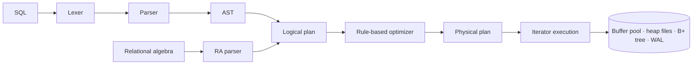

# mini-db-engine

[](https://github.com/santiagosantofimio/mini-db-engine/actions/workflows/ci.yml)

An embedded relational database engine written from scratch in Java, with zero runtime dependencies.

It keeps everything in a single paged file, indexes with an on-disk B+ tree, understands a subset of SQL, compiles every query into a relational algebra plan, and runs that plan with iterator-model operators. A write-ahead log lets committed transactions survive crashes, and a second REPL mode accepts relational algebra directly.

## Status

Built in phases, each one merged with its tests green.

- [x] **0. Project setup:** Maven build, CI, package layout, error hierarchy
- [x] **1. Storage:** pager, LRU buffer pool, slotted pages, heap files, tuple serialization
- [ ] **2. First queries:** catalog, lexer, parser, `CREATE TABLE`, `INSERT`, `SELECT ... WHERE`, REPL
- [ ] **3. B+ tree:** splits, point and range lookups, `PRIMARY KEY`, `CREATE INDEX`
- [ ] **4. Planner and executor:** rule-based optimizer, joins, `ORDER BY`, `LIMIT`, `UPDATE`, `DELETE`, `EXPLAIN`
- [ ] **5. Transactions and recovery:** WAL, `BEGIN` / `COMMIT` / `ROLLBACK`, checkpoints
- [ ] **6. Aggregation:** `GROUP BY`, `HAVING`, `COUNT`, `SUM`, `AVG`, `MIN`, `MAX`
- [ ] **7. Relational algebra mode:** set operators, natural join, `EXPLAIN` round trip

## Getting started

You need JDK 21 or newer. Maven is optional: the bundled wrapper downloads the right version.

```bash
./mvnw package
java -jar target/minidb.jar --version
```

## Architecture

SQL and relational algebra share everything from the logical plan onward.



| Package | Responsibility |
|---|---|
| `storage` | Pager over `FileChannel`, LRU buffer pool, slotted pages |
| `record` | Types, schemas, tuples and their binary format |
| `catalog` | Tables, columns and indexes, persisted in pages |
| `index` | On-disk B+ tree |
| `sql` | SQL lexer, parser and AST |
| `ra` | Relational algebra lexer and parser |
| `plan` | Logical plan, planner and rule-based optimizer |
| `exec` | Physical operators (`open` / `next` / `close`) |
| `tx` | Write-ahead log, transactions and recovery |
| `cli` | REPL, meta-commands and table rendering |

## Storage format

A database is one file of 4096-byte pages, big-endian throughout. Page 0 is the header. Every other page starts with a one-byte type: `HEAP` (1), `BTREE_INTERNAL` (2), `BTREE_LEAF` (3), `CATALOG` (4) or `FREE` (5).

### Header

| Offset | Size | Field |
|---|---|---|
| 0 | 8 | Magic bytes `MINIDB01` |
| 8 | 4 | Format version (`1`) |
| 12 | 4 | Page size (`4096`) |
| 16 | 4 | Page count |
| 20 | 4 | Head of the free page list |
| 24 | 4 | Catalog root page |

Page 0 can never hold data, so page id `0` means "no page" in every pointer. Freed pages form a linked list, each one storing the next free page right after its type byte, and they are reused before the file grows.

### Heap pages

Tables are chains of slotted pages:

```text
0      1            3                5           9
┌──────┬────────────┬────────────────┬───────────┬──────────────────┬──────────┬─────────────┐
│ type │ slot count │ free space end │ next page │ slot directory → │   free   │ ← records   │
└──────┴────────────┴────────────────┴───────────┴──────────────────┴──────────┴─────────────┘
```

Each slot holds a 2-byte record offset and a 2-byte length, and offset `0` marks an empty slot. A record id (RID) is `(page id, slot)`. Deleting a row empties its slot. When an insert needs space that deletes left scattered, the page compacts its records but keeps every slot number, so RIDs never change.

### Tuples

A tuple is a null bitmap (bit `i % 8` of byte `i / 8` is set when column `i` is `NULL`) followed by the non-null fields in column order:

| Type | Encoding |
|---|---|
| `INT` | 4 bytes, two's complement |
| `DOUBLE` | 8 bytes, IEEE 754 |
| `BOOLEAN` | 1 byte, `0` or `1` |
| `VARCHAR(n)` | 2-byte length in bytes, then UTF-8 |

For example, `(7, 'Ana', NULL, TRUE)` with columns `INT, VARCHAR, DOUBLE, BOOLEAN` encodes as `04 00000007 0003 416E61 01`. A tuple must fit in one page, which leaves room for 4083 bytes.

## Scope

These limits are deliberate. They keep the project focused on the core ideas:

- One process and one writer at a time, no network server.
- A subset of SQL, not the full standard.
- A tuple must fit in one page; there are no overflow pages.
- Index keys are `INT`.
- A transaction can modify at most as many pages as the buffer pool holds.

## Design decisions

Each phase records its key decisions and the alternatives it rejected in [`docs/decisions.md`](docs/decisions.md).

## Running the tests

```bash
./mvnw verify
```

Run a single test class:

```bash
./mvnw test -Dtest=MainTest
```

## License

[MIT](LICENSE)
