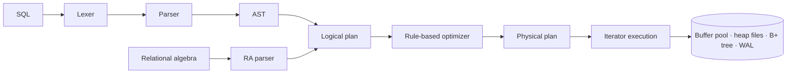

# mini-db-engine

[](https://github.com/santiagosantofimio/mini-db-engine/actions/workflows/ci.yml)

An embedded relational database engine written from scratch in Java, with zero runtime dependencies.

It keeps everything in a single paged file, indexes with an on-disk B+ tree, understands a subset of SQL, compiles every query into a relational algebra plan, and runs that plan with iterator-model operators. A write-ahead log lets committed transactions survive crashes, and a second REPL mode accepts relational algebra directly.

## Status

Built in phases, each one merged with its tests green.

- [x] **0. Project setup:** Maven build, CI, package layout, error hierarchy
- [ ] **1. Storage:** pager, LRU buffer pool, slotted pages, tuple serialization
- [ ] **2. First queries:** catalog, lexer, parser, `CREATE TABLE`, `INSERT`, `SELECT ... WHERE`, REPL
- [ ] **3. B+ tree:** splits, point and range lookups, `PRIMARY KEY`, `CREATE INDEX`
- [ ] **4. Planner and executor:** rule-based optimizer, joins, `ORDER BY`, `LIMIT`, `UPDATE`, `DELETE`, `EXPLAIN`
- [ ] **5. Transactions and recovery:** WAL, `BEGIN` / `COMMIT` / `ROLLBACK`, checkpoints
- [ ] **6. Aggregation:** `GROUP BY`, `HAVING`, `COUNT`, `SUM`, `AVG`, `MIN`, `MAX`
- [ ] **7. Relational algebra mode:** set operators, natural join, `EXPLAIN` round trip

## Getting started

You need JDK 21 or newer. Maven is optional: the bundled wrapper downloads the right version.

```bash
./mvnw package
java -jar target/minidb.jar --version
```

## Architecture

SQL and relational algebra share everything from the logical plan onward.



| Package | Responsibility |
|---|---|
| `storage` | Pager over `FileChannel`, LRU buffer pool, slotted pages |
| `record` | Types, schemas, tuples and their binary format |
| `catalog` | Tables, columns and indexes, persisted in pages |
| `index` | On-disk B+ tree |
| `sql` | SQL lexer, parser and AST |
| `ra` | Relational algebra lexer and parser |
| `plan` | Logical plan, planner and rule-based optimizer |
| `exec` | Physical operators (`open` / `next` / `close`) |
| `tx` | Write-ahead log, transactions and recovery |
| `cli` | REPL, meta-commands and table rendering |

## Scope

These limits are deliberate. They keep the project focused on the core ideas:

- One process and one writer at a time, no network server.
- A subset of SQL, not the full standard.
- A tuple must fit in one page; there are no overflow pages.
- Index keys are `INT`.
- A transaction can modify at most as many pages as the buffer pool holds.

## Design decisions

Each phase records its key decisions and the alternatives it rejected in [`docs/decisions.md`](docs/decisions.md).

## Running the tests

```bash
./mvnw verify
```

Run a single test class:

```bash
./mvnw test -Dtest=MainTest
```
