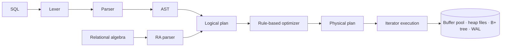

# mini-db-engine

[](https://github.com/santiagosantofimio/mini-db-engine/actions/workflows/ci.yml)

An embedded relational database engine written from scratch in Java, with zero runtime dependencies.

It keeps everything in a single paged file, indexes with an on-disk B+ tree, understands a subset of SQL, compiles every query into a relational algebra plan, and runs that plan with iterator-model operators. A write-ahead log lets committed transactions survive crashes, and a second REPL mode accepts relational algebra directly.

## Status

Built in phases, each one merged with its tests green.

- [x] **0. Project setup:** Maven build, CI, package layout, error hierarchy
- [x] **1. Storage:** pager, LRU buffer pool, slotted pages, heap files, tuple serialization
- [x] **2. First queries:** catalog, lexer, parser, `CREATE TABLE`, `DROP TABLE`, `INSERT`, `SELECT ... WHERE`, REPL
- [x] **3. B+ tree:** splits, point and range lookups, `PRIMARY KEY`, `CREATE INDEX`, `.btree`
- [ ] **4. Planner and executor:** rule-based optimizer, joins, `ORDER BY`, `LIMIT`, `UPDATE`, `DELETE`, `EXPLAIN`
- [ ] **5. Transactions and recovery:** WAL, `BEGIN` / `COMMIT` / `ROLLBACK`, checkpoints
- [ ] **6. Aggregation:** `GROUP BY`, `HAVING`, `COUNT`, `SUM`, `AVG`, `MIN`, `MAX`
- [ ] **7. Relational algebra mode:** set operators, natural join, `EXPLAIN` round trip

## Getting started

You need JDK 21 or newer. Maven is optional: the bundled wrapper downloads the right version.

```bash
./mvnw package
java -jar target/minidb.jar demo.db
```

The file is created if it does not exist. Load the example university data and query it:

```text
minidb> .read examples/university.sql
minidb> SELECT name, age, major FROM students
   ...> WHERE major = 'Computer Science' AND age >= 21;
┌───────────────┬─────┬──────────────────┐
│ name          │ age │ major            │
├───────────────┼─────┼──────────────────┤
│ Ana Torres    │  21 │ Computer Science │
│ Camila Rojas  │  23 │ Computer Science │
│ Julián Ortega │  25 │ Computer Science │
└───────────────┴─────┴──────────────────┘
3 rows in 0.41 ms
minidb> SELECT nme FROM students;
Error at line 1, column 8: unknown column nme
  SELECT nme FROM students;
         ^
```

Statements end with `;` and may span several lines. `--buffer-pages N` sets the buffer pool size (1024 pages by default, at least 16), and `--btree-order N` caps the keys per B+ tree node (between 3 and 408, the most that fit in a page by default) so small trees show their splits. The REPL has no line editing of its own, since that would need a dependency; run it under `rlwrap` for history and arrow keys.

| Command | What it does |
|---|---|
| `.help` | List the commands |
| `.tables` | List the tables |
| `.schema [table]` | Show `CREATE TABLE` and `CREATE INDEX` statements |
| `.indexes [table]` | List the indexes |
| `.btree <index>` | Print a B+ tree level by level |
| `.stats` | Show buffer pool hits, misses and evictions |
| `.read <file>` | Run the SQL in a file, stopping at the first error |
| `.exit` | Leave the REPL |

When standard input is not a terminal, the REPL prints no prompts or colors and exits with status 1 if any statement failed, so it also works in scripts:

```bash
java -jar target/minidb.jar demo.db < examples/university.sql
```

## Supported SQL

```sql
CREATE TABLE students (id INT PRIMARY KEY, name VARCHAR(40) NOT NULL, age INT, gpa DOUBLE);
CREATE INDEX students_age ON students (age);
INSERT INTO students (id, name) VALUES (1, 'Ana'), (2, 'Bruno');
SELECT s.name, s.gpa * 10 AS score FROM students s WHERE s.gpa BETWEEN 3.0 AND 4.0;
DROP TABLE students;
```

- **Types:** `INT` (32-bit), `DOUBLE`, `BOOLEAN` and `VARCHAR(n)` with `n` up to 4000 characters.
- **Constraints:** `PRIMARY KEY` on one `INT` column (unique, implies `NOT NULL`, backed by an index named `<table>_pkey`), `NOT NULL` and the `VARCHAR` length. An `INSERT` checks every row, including duplicate keys, before writing any of them.
- **Indexes:** `CREATE INDEX name ON table (column)` on `INT` columns. Indexes are filled from the existing rows and kept up to date by every `INSERT`; `NULL` values are not indexed. The query planner starts using them in phase 4.
- **Expressions:** literals, columns (`t.column`), `+ - * /`, `= <> != < <= > >=`, `BETWEEN`, `IS [NOT] NULL`, `AND`, `OR`, `NOT` and parentheses. `INT / INT` truncates; overflow and division by zero are errors.
- **`NULL`** follows SQL's three-valued logic: comparing with `NULL` gives `NULL`, and `WHERE` keeps only rows whose condition is `TRUE`.
- **Names** are case-insensitive. Keywords cannot be used as names, and select-list aliases need `AS`.
- `--` starts a comment that runs to the end of the line.

## Architecture

SQL and relational algebra share everything from the logical plan onward.



| Package | Responsibility |
|---|---|
| `storage` | Pager over `FileChannel`, LRU buffer pool, slotted pages |
| `record` | Types, schemas, tuples and their binary format |
| `catalog` | Tables, columns and indexes, persisted in pages |
| `index` | On-disk B+ tree |
| `sql` | SQL lexer, parser and AST |
| `ra` | Relational algebra lexer and parser |
| `plan` | Logical plan, planner and rule-based optimizer |
| `exec` | Physical operators (`open` / `next` / `close`) |
| `tx` | Write-ahead log, transactions and recovery |
| `cli` | REPL, meta-commands and table rendering |

## Storage format

A database is one file of 4096-byte pages, big-endian throughout. Page 0 is the header. Every other page starts with a one-byte type: `HEAP` (1), `BTREE_INTERNAL` (2), `BTREE_LEAF` (3), `CATALOG` (4) or `FREE` (5).

### Header

| Offset | Size | Field |
|---|---|---|
| 0 | 8 | Magic bytes `MINIDB01` |
| 8 | 4 | Format version (`1`) |
| 12 | 4 | Page size (`4096`) |
| 16 | 4 | Page count |
| 20 | 4 | Head of the free page list |
| 24 | 4 | Catalog root page |

Page 0 can never hold data, so page id `0` means "no page" in every pointer. Freed pages form a linked list, each one storing the next free page right after its type byte, and they are reused before the file grows.

### Heap pages

Tables are chains of slotted pages:

```text
0      1            3                5           9
┌──────┬────────────┬────────────────┬───────────┬──────────────────┬──────────┬─────────────┐
│ type │ slot count │ free space end │ next page │ slot directory → │   free   │ ← records   │
└──────┴────────────┴────────────────┴───────────┴──────────────────┴──────────┴─────────────┘
```

Each slot holds a 2-byte record offset and a 2-byte length, and offset `0` marks an empty slot. A record id (RID) is `(page id, slot)`. Deleting a row empties its slot. When an insert needs space that deletes left scattered, the page compacts its records but keeps every slot number, so RIDs never change.

### Tuples

A tuple is a null bitmap (bit `i % 8` of byte `i / 8` is set when column `i` is `NULL`) followed by the non-null fields in column order:

| Type | Encoding |
|---|---|
| `INT` | 4 bytes, two's complement |
| `DOUBLE` | 8 bytes, IEEE 754 |
| `BOOLEAN` | 1 byte, `0` or `1` |
| `VARCHAR(n)` | 2-byte length in bytes, then UTF-8 |

For example, `(7, 'Ana', NULL, TRUE)` with columns `INT, VARCHAR, DOUBLE, BOOLEAN` encodes as `04 00000007 0003 416E61 01`. A tuple must fit in one page, which leaves room for 4083 bytes.

### B+ tree nodes

Each index is a B+ tree with one node per page. Entries are `(key, RID)` pairs ordered by key and then by RID, so duplicate keys in secondary indexes still have a total order.

| Node | Header (7 bytes) | Body | Capacity |
|---|---|---|---|
| `BTREE_LEAF` | type, entry count, next leaf | entries of key (4) + page id (4) + slot (2) | 408 entries |
| `BTREE_INTERNAL` | type, key count, first child | separators of 10 bytes, each followed by a 4-byte child | 292 keys |

The leaf links let a range scan walk from one leaf to the next without going back up the tree. When the root splits, its contents move to a new page and the root page becomes the new parent, so an index's root page never changes.

### Catalog

The header's catalog root points to a chain of `CATALOG` slotted pages holding one record per table or index. Strings are a 2-byte length followed by UTF-8.

- **Table** (kind `1`): name, first heap page, column count, and for each column its name, a type code (`1` `INT`, `2` `DOUBLE`, `3` `BOOLEAN`, `4` `VARCHAR` followed by its 2-byte length) and a nullable flag.
- **Index** (kind `2`): name, table name, column position, root page and a primary key flag.

The catalog is read into memory when the database opens and written through on every `CREATE` and `DROP`.

## Scope

These limits are deliberate. They keep the project focused on the core ideas:

- One process and one writer at a time, no network server.
- A subset of SQL, not the full standard.
- A tuple must fit in one page; there are no overflow pages.
- Index keys are `INT`.
- A transaction can modify at most as many pages as the buffer pool holds.

## Design decisions

Each phase records its key decisions and the alternatives it rejected in [`docs/decisions.md`](docs/decisions.md).

## Running the tests

```bash
./mvnw verify
```

Run a single test class:

```bash
./mvnw test -Dtest=MainTest
```

## License

[MIT](LICENSE)
